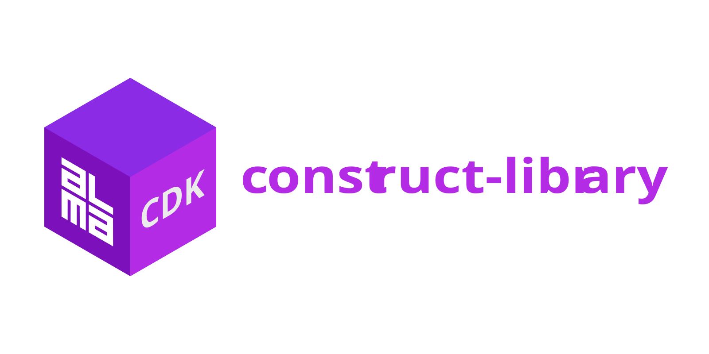

<div align="center">
  <h1>
	
  <br/>
  <br/>
  </h1>

  
  
  [](https://github.com/alma-cdk/construct-library/actions/workflows/release.yml)
  [](https://sonarcloud.io/summary/new_code?id=alma-cdk_construct-library)
  [](https://sonarcloud.io/summary/new_code?id=alma-cdk_construct-library)
  <hr/>
</div>

Custom [Projen Project Type](https://projen.io/docs/concepts/projects/building-your-own/) to manage all the `alma-cdk/*` CDK construts.

## Installation

1. Install with `npm`:
    ```sh
    npm i -D @alma-cdk/construct-library
    ```

2. If existing project, install `npm i -D projen@0.105.8` or newer

2. Import the custom Projen project type:
    ```diff
    - import { AwsCdkConstructLibrary } from 'projen/lib/awscdk';
    + import { cdk } from "projen";
    + import { AlmaCdkConstructLibrary } from "@alma-cdk/construct-library";
    ```

3. Initialize and define (at least) minimum required configuration:
    ```ts
    const project = new AlmaCdkConstructLibrary({
      name: "@<SCOPE>/<PACKAGE_NAME>", // or "<PACKAGE_NAME>"
      author: "<AUTHOR_ORGANIZATION_NAME>",
      authorAddress: "<AUTHOR_ORGANIZATION_EMAIL>",
      description: "<PACKAGE_DESCRIPTION>",
      repositoryUrl: "https://<GIT_URL>.git",
      stability: cdk.Stability.EXPERIMENTAL, // or STABLE or DEPRECATED
      majorVersion: 0, // 1, 2, ...
      releaseEnvironment: "production",
    });

    project.synth();
    ```


4. Fnm use 24 

4. Install `pnpm`

5. Run `projen` with `pnpm`:
    ```sh
    pnpm exec projen
    ```

6. Ensure correct Node version: `fnm use`

7. Remove old `node_modules`, `yarn.lock`, and/or `package-lock.json` files

8. Reinstall everything with `pnpm install`

## Release branches

`majorVersion` is required and defines what the default `main` branch releases as `latest`. From it the library also derives a release branch for the **next** major version, published as a `beta` prerelease under the `beta` npm dist-tag – so work on the next major can ship without moving `latest`:

```ts
const project = new AlmaCdkConstructLibrary({
  // ...
  majorVersion: 3, // `main` releases 3.x as `latest`, `4.x` branch releases 4.0.0-beta.N as `beta`
});
```

Anything passed in `releaseBranches` is merged on top of that default, keyed by branch name:

```ts
releaseBranches: {
  // added alongside the generated `4.x` branch
  "legacy-2.x": { majorVersion: 2, npmDistTag: "legacy" },
},
```

Using the next major branch name as the key replaces the generated configuration for it (the entry is taken as-is, not merged field by field):

```ts
releaseBranches: {
  // replaces the default `4.x` beta configuration
  "4.x": { majorVersion: 4, prerelease: "rc", npmDistTag: "next" },
},
```

Note: downstream projects that previously declared the `${MAJOR_VERSION + 1}.x` branch by hand can now drop it – the generated default is identical.

## Upgrading pnpm

The pnpm version is pinned by this library – both in the package.json `packageManager` field (used locally) and in the CI workflows – so it upgrades together with the library:

1. Upgrade the dependency: `pnpm exec projen upgrade` (or merge the automated upgrade PR)

2. Regenerate the `packageManager` field and workflows:
    ```sh
    pnpm exec projen
    ```

3. Install with the new version, which pnpm self-downloads and switches to:
    ```sh
    pnpm install
    ```

4. Commit the regenerated files: `package.json`, `.github/workflows/*` and `pnpm-lock.yaml`

Notes:

- On a pnpm **major** upgrade `node_modules` is recreated; without a TTY to confirm, use `CI=true pnpm install`.

- `pnpmSettings` only accepts settings that the pinned pnpm still supports, so options dropped by pnpm v11 are rejected at synth. Most notably, replace `onlyBuiltDependencies` with `allowBuilds: { '<package>': true }` – pnpm v11 ignores the former, skipping the builds (which fails the install under `strictDepBuilds`).

- pnpm v12 fails every command when `pnpm-workspace.yaml` has a setting it does not recognize, so `pnpmSettings` also rejects `packageManagerStrict`, `packageManagerStrictVersion` and `managePackageManagerVersions`. Remove them from `pnpmSettings`.

## Upgrading downstream packages

```sh
pnpm add -D @alma-cdk/construct-library@2.2 constructs@10.7 projen@0.105.8
```
